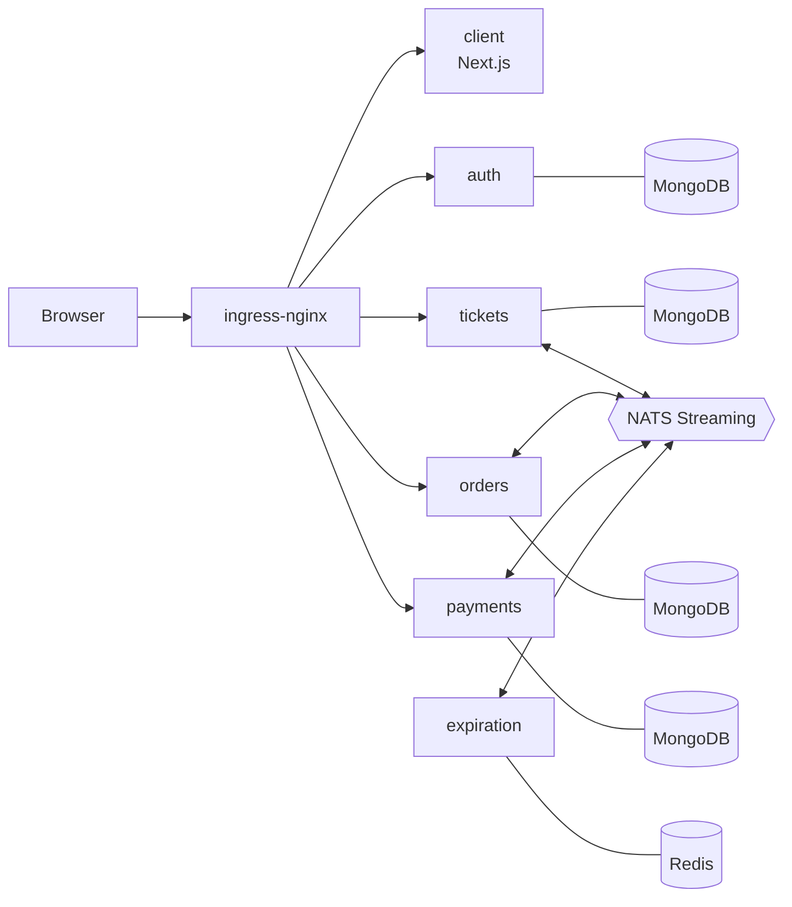

# Ticketing: Event-Driven Microservices Marketplace

A ticket marketplace built as a set of independent microservices. Users sign up, list tickets for sale, reserve them by creating orders, and pay with Stripe. Unpaid orders expire automatically and release their tickets.

The project is a hands-on study of production-style backend and DevOps practice: event-driven communication, Kubernetes, CI, and GitOps, all running locally on Minikube.

## Tech stack

| Area | Technologies |
|---|---|
| Backend | Node.js, TypeScript, Express, Mongoose |
| Frontend | React, Next.js (server-side rendering) |
| Data | MongoDB (one database per service), Redis |
| Messaging | NATS Streaming Server |
| Payments | Stripe API |
| Containers and orchestration | Docker, Kubernetes (Minikube), ingress-nginx, Skaffold |
| CI/CD and GitOps | GitHub Actions, Argo CD |
| Testing | Jest, Supertest, mongodb-memory-server |
| Shared code | Private-scope npm package (`@elsrogy-tickets/common`) |

## Architecture



### Services

| Service | Responsibility |
|---|---|
| `auth` | Sign up, sign in, sign out, current user. Issues a JWT stored in a cookie session. |
| `tickets` | Create, read, and update tickets. Locks a ticket while an order reserves it. |
| `orders` | Create and cancel orders, reserve tickets. Keeps its own replica of ticket data. |
| `payments` | Charges orders through Stripe and records the payment. |
| `expiration` | Schedules a delayed job per order (Redis-backed queue) and signals when it expires. |
| `client` | Next.js web app: authentication, ticket listing, order and payment pages. |
| `common` | Shared npm package: custom errors, middleware, event types, and base publisher/listener classes. |

### Events

Services never call each other directly. They publish and listen to events on NATS.

| Event | Published by | Reacted to by |
|---|---|---|
| `ticket:created` / `ticket:updated` | tickets | orders |
| `order:created` | orders | tickets, payments, expiration |
| `order:cancelled` | orders | tickets, payments |
| `expiration:complete` | expiration | orders |
| `payment:created` | payments | orders |

## Key engineering decisions

- **Database per service.** Each service owns its data. Where a service needs another service's data (for example, orders needs ticket prices), it keeps a replica updated through events.
- **Typed events with generics.** `Publisher<T>` and `Listener<T>` base classes in `common` give compile-time checking of event subjects and payloads, so a changed event shape fails the build in every service.
- **Reliable delivery.** Listeners use manual acknowledgement, durable subscriptions, and queue groups, so a crash redelivers the event and replicas share the work.
- **Optimistic concurrency.** Versioned documents and version-checked event handling prevent out-of-order or concurrent updates from overwriting newer data.
- **Consistent error handling.** An abstract `CustomError` hierarchy plus one error-handling middleware gives every service the same JSON error format.
- **Shared library.** Common code is published as a versioned npm package rather than copied between services.
- **Stateless authentication.** A signed JWT in a cookie session lets any service identify the user without calling the auth service.
- **Isolated tests.** Each service runs against an in-memory MongoDB, with NATS and Stripe replaced by test doubles.

## DevOps

- **Kubernetes:** a Deployment and Service per application and per database, an Ingress for routing, and Secrets for credentials (`JWT_KEY`, `STRIPE_KEY`).
- **Local development:** Skaffold builds images and syncs source changes into running pods.
- **CI:** a GitHub Actions workflow detects which service folders changed and runs only those services' tests.
- **GitOps:** an Argo CD application manifest (`argocd-app.yaml`) for syncing the `infra/k8s` manifests from Git.

## Repository layout

```
.
├── auth/  tickets/  orders/  payments/  expiration/   # backend services
├── client/                                            # Next.js frontend
├── common/                                            # shared npm package
├── infra/k8s/                                         # Kubernetes manifests
├── nats-test/                                         # NATS pub/sub playground
├── skaffold.yaml
├── argocd-app.yaml
└── .github/workflows/ci.yaml
```

## Running locally

**Prerequisites:** Docker, Minikube, kubectl, Skaffold.

```bash
# 1. Start the cluster and ingress controller
minikube start
minikube addons enable ingress

# 2. Create secrets (names must match the deployment manifests)
kubectl create secret generic jwt-secret --from-literal=JWT_KEY=<your-secret>
kubectl create secret generic stripe-secret --from-literal=STRIPE_KEY=<your-stripe-test-key>

# 3. Expose the ingress (keep this running in its own terminal)
minikube tunnel

# 4. Point the domain at the ingress IP
kubectl get svc -n ingress-nginx     # copy EXTERNAL-IP
# add to /etc/hosts:  <EXTERNAL-IP> ticketing.dev

# 5. Build and deploy everything
skaffold dev
```

Open `https://ticketing.dev`. The ingress uses a self-signed certificate, so the browser shows a warning you can bypass for local use.

## Running the tests

Each service has its own test suite:

```bash
cd <service>
npm install
npm test
```

## What I learned building this

- Designing service boundaries and keeping data consistent without shared databases.
- Handling failure in distributed systems: retries, acknowledgements, ordering, and idempotent handlers.
- Debugging real infrastructure problems, such as Kubernetes networking, image rebuilds, and ESM/TypeScript tooling.
- Publishing and versioning a shared package used by several services.